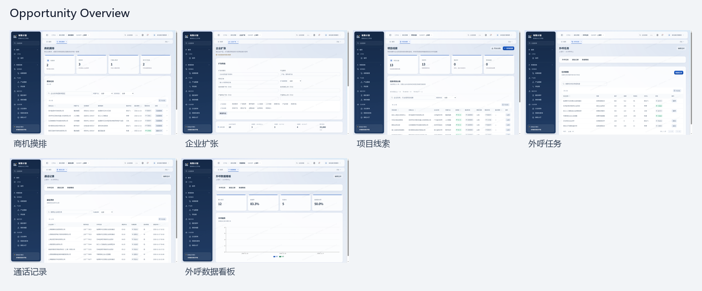
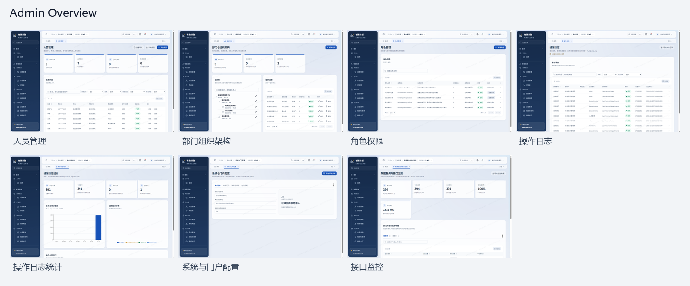
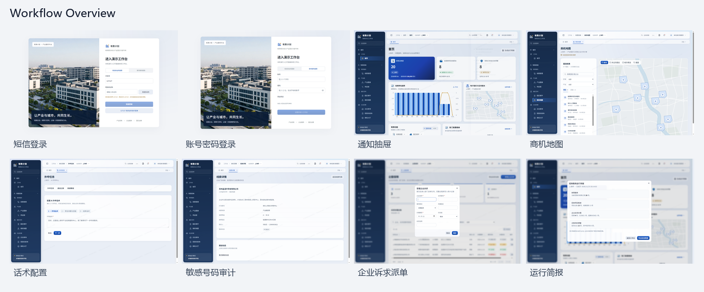

# 有数计划 · 政务招商与安商稳商工作台

供地方政府委办局、产业园区管委会内部使用的招商稳商工作台，涵盖政策、园区、企业、项目线索、诉求办理、组织权限和操作审计。React 19 工作台承载全部业务路由，Spring Boot 后端提供认证、权限守卫、行级数据过滤、审计和 MySQL 8.4 持久化。

> 本项目当前运行于本地政务演示环境，企业、园区、政策和审计初始化数据为模拟记录。短信网关、真实电话外呼和外部业务数据源仍需由部署单位提供服务凭据。

新会话交接请先阅读 [PROJECT_SESSION_SUMMARY.md](PROJECT_SESSION_SUMMARY.md)。

## 技术栈

- 前端：React 19、React Router、Vite 5、Tailwind CSS 4、shadcn/ui（Base UI）、Recharts、Cloudflare Turnstile。
- 后端：Java 21、Spring Boot 3.4.5、Spring JDBC、MySQL 8.4、springdoc-openapi。
- 地图：SVG 示意底图与本地园区点位，支持范围圈选和关联企业筛选。

## 本地启动

准备 Node.js 20.19+、Docker Desktop 和网络连接。首次构建需要下载依赖，并拉取 MySQL 8.4 镜像。Compose 会在 MySQL 健康检查通过后启动 API。

```bash
npm install
docker compose -p youshu-local up -d --build
npm run dev
```

访问 <http://127.0.0.1:5199>。前端将 `/api` 代理到 `127.0.0.1:8080`。MySQL 在本机绑定 `127.0.0.1:3307`，默认开发连接为数据库 `youshu`、用户 `youshu`、密码 `youshu_local`。本地端口和凭据可通过根目录 `.env` 中的 `MYSQL_HOST_PORT`、`MYSQL_USER`、`MYSQL_PASSWORD` 和 `MYSQL_ROOT_PASSWORD` 覆盖。表结构和完整政务演示数据分别保存在 [schema.sql](backend/sql/mysql/schema.sql) 与 [seed.sql](backend/sql/mysql/seed.sql)。MySQL 首次创建数据卷时会自动执行这两份 SQL，应用启动会补齐政务内置角色与安全字段。

默认连接配置可直接运行。需要调整端口或密码时，将 `.env.example` 复制为 `.env` 并编辑对应值。

### 认证配置

Compose 的本机演示环境默认开启演示登录。登录页手机号预填 `127127`，点击「127127 免验证码演示登录」可以直接进入工作台。也可以点击「发送验证码」，使用服务端返回的演示短信码 `127127` 完成短信登录。演示短信码只在 `APP_AUTH_DEMO_LOGIN_ENABLED=true` 时有效，应用配置默认关闭该开关。

账号密码登录使用 Cloudflare Turnstile。`compose.yaml` 内置 Cloudflare 官方测试 site key 和 secret key，便于本机验收。成员密码至少 12 位，并按系统配置要求包含字母和数字。连续输错 5 次后锁定 15 分钟，登录会话默认 30 分钟无操作后失效。部署到真实环境时，用环境变量配置可信验证码与短信服务，并把 `APP_AUTH_DEMO_LOGIN_ENABLED` 设为 `false`。

```dotenv
APP_AUTH_DEMO_LOGIN_ENABLED=false
APP_AUTH_DEMO_PHONE=127127
APP_AUTH_DEMO_SMS_CODE=127127
APP_AUTH_DEVICE_VERIFICATION_ENABLED=true
APP_AUTH_TURNSTILE_SITE_KEY=你的 Turnstile Site Key
APP_AUTH_TURNSTILE_SECRET_KEY=你的 Turnstile Secret Key
```

当前仓库没有真实短信服务商凭证，因此其他手机号会得到「尚未配置真实短信服务」的明确响应。短信接口契约已经保留在 `/api/auth/sms/send` 和 `/api/auth/sms/login`，接入供应商时只需替换服务端发送实现。账号密码首次登录或未信任设备时，服务端可以发起短信设备验证，并在勾选信任设备后保存 90 天可信设备 token。

### 停止与数据

前端终端按 `Ctrl+C`，然后执行：

```bash
docker compose -p youshu-local down
```

命令会保留 Docker 卷 `youshu-local_youshu_mysql_data` 中的 MySQL 数据。不要加 `-v`，否则会删除数据库卷。首次启动会从 SQL 导入模拟业务记录，后端会为新业务集合补齐初始数据。后续启动不会覆盖已编辑记录。

## 系统操作说明

截图使用隔离的本地演示数据库，所有应用视图固定为 **1440 × 900**。模块总览把同一模块的页面排在一起，展开下方索引可打开每个页面的原尺寸截图。页面索引覆盖全部工作台导航、业务详情、登录、安全查阅、通知、地图圈选、诉求派单和运行简报状态。

### 全部功能总览










<details>
<summary>打开全部页面的 1440 × 900 原尺寸截图索引</summary>

#### 首页

| 页面 | 截图 |
| --- | --- |
| 首页与 Bento 工作台 | [查看原图](docs/screenshots/features/home.png) |

#### 智慧招商

| 页面 | 截图 |
| --- | --- |
| 政策管理与项目匹配 | [查看原图](docs/screenshots/features/policy.png) |
| 产业图谱 | [查看原图](docs/screenshots/features/industry-chart.png) |
| 供应链 | [查看原图](docs/screenshots/features/supply-chain.png) |
| 园区楼宇 | [查看原图](docs/screenshots/features/parks-buildings.png) |
| 商机地图与范围圈选 | [查看原图](docs/screenshots/features/business-map.png) |
| 企业查询 | [查看原图](docs/screenshots/features/company-search.png) |
| 招投标查询 | [查看原图](docs/screenshots/features/bidding.png) |
| 商机大厅 | [查看原图](docs/screenshots/features/business-hall.png) |

#### 商机洞察

| 页面 | 截图 |
| --- | --- |
| 商机摸排 | [查看原图](docs/screenshots/features/business-investigate.png) |
| 企业扩张 | [查看原图](docs/screenshots/features/enterprise-expansion.png) |
| 项目线索池 | [查看原图](docs/screenshots/features/project-clues.png) |
| AI 外呼任务 | [查看原图](docs/screenshots/features/ai-outbound-tasks.png) |
| AI 通话记录 | [查看原图](docs/screenshots/features/ai-outbound-records.png) |
| AI 外呼数据看板 | [查看原图](docs/screenshots/features/ai-outbound-dashboard.png) |

#### 安商稳商

| 页面 | 截图 |
| --- | --- |
| 全景洞察 | [查看原图](docs/screenshots/features/panoramic-insight.png) |
| 园区管理 | [查看原图](docs/screenshots/features/campus-admin.png) |
| 企业档案与多维筛选 | [查看原图](docs/screenshots/features/corporate-archives.png) |
| 迁移预警 | [查看原图](docs/screenshots/features/migration-warning.png) |
| 企服保障 | [查看原图](docs/screenshots/features/guarantee.png) |
| 走访管理 | [查看原图](docs/screenshots/features/visit-manage.png) |

#### 平台管理

| 页面 | 截图 |
| --- | --- |
| 人员管理 | [查看原图](docs/screenshots/features/members.png) |
| 部门与组织架构 | [查看原图](docs/screenshots/features/departments.png) |
| 角色管理与权限配置 | [查看原图](docs/screenshots/features/roles.png) |
| 操作日志 | [查看原图](docs/screenshots/features/logs.png) |
| 操作日志统计 | [查看原图](docs/screenshots/features/log-statistics.png) |
| 系统与门户配置 | [查看原图](docs/screenshots/features/system-settings.png) |
| 数据服务与接口监控 | [查看原图](docs/screenshots/features/interface-monitoring.png) |

#### 详情页面

| 页面 | 截图 |
| --- | --- |
| 政策详情 | [查看原图](docs/screenshots/features/policy-detail.png) |
| 企业详情 | [查看原图](docs/screenshots/features/company-detail.png) |
| 园区详情 | [查看原图](docs/screenshots/features/park-detail.png) |
| 项目线索详情 | [查看原图](docs/screenshots/features/clue-detail.png) |

#### 登录及业务交互

| 状态 | 截图 |
| --- | --- |
| 短信演示登录与 127127 免验证码入口 | [查看原图](docs/screenshots/login.png) |
| 账号密码与图片验证码登录 | [查看原图](docs/screenshots/login-password.png) |
| 通知中心右侧抽屉 | [查看原图](docs/screenshots/notifications.png) |
| 政策详情右侧抽屉 | [查看原图](docs/screenshots/features/policy-detail-drawer.png) |
| 商机地图多边形圈选 | [查看原图](docs/screenshots/map.png) |
| AI 外呼话术配置引导 | [查看原图](docs/screenshots/features/ai-outbound-setup.png) |
| 项目线索完整信息与敏感号码查阅 | [查看原图](docs/screenshots/features/project-sensitive-phone.png) |
| 企业诉求派单与督办 | [查看原图](docs/screenshots/features/service-requests.png) |
| 运行简报预览 | [查看原图](docs/screenshots/features/run-brief.png) |

</details>

### 登录与演示环境

本机演示环境打开即显示短信登录。手机号默认是 `127127`，可使用免验证码按钮进入，也可发送并输入演示码 `127127`。新 MySQL 数据库首次启动时还没有本地管理员，首次使用账号密码页会引导创建账号。账号至少 3 个字符，密码至少 12 位并按当前策略校验，密码登录须完成人机验证。关闭 Turnstile 配置时，后端会回退到绑定 Session 的图片验证码，验证码 5 分钟有效且提交后失效。新增成员首次登录和管理员重置密码后均须修改初始密码。

全套界面截图使用 **1440 × 900** 固定视口，从本机 MySQL 政务演示环境采集。企业和联系方式均为合成样例数据。AI 外呼截图覆盖本地演示话术配置、任务、通话记录和看板。

### 业务操作

- **政策管理**：按地区、级别、行业或关键词筛选。点击一行可在右侧查看申报条件、扶持力度和截止日期，并生成海报。一键政策匹配根据企业名称、行业和区域计算匹配分数。
- **园区楼宇**：按区域、载体类型或关键词筛选，切换卡片和列表，点击园区查看详情。新增载体保存到 MySQL，刷新后可继续查看。
- **园区管理与走访**：维护园区及楼宇运营信息，创建走访工单，完成时填写结果。工单、状态和完成记录都会保存。
- **项目线索**：企业与项目内容依政务授权直接展示，手机号列表默认掩码。具备 `view_sensitive` 权限的成员可查阅完整号码，该访问写入 `op_log`。项目可公海认领、查重、退回公海，并按“线索摸排 → 研判评审 → 载体选址匹配 → 拟签约 → 落地纳统”推进。
- **组织和三员分立**：部门树维护委办局、招商处室和园区工作组。菜单路由与具体操作权限分开校验，支持 `ALL_PARKS`、`ASSIGNED_PARKS`、`SELF_ONLY` 数据范围。系统管理员维护账号和菜单，安全保密员维护数据范围与敏感信息策略，安全审计员只读查阅日志。内置三员角色不可删除或修改。
- **账号安全**：人员管理支持部门/角色/数据范围筛选、初始密码和管理员重置、首次登录改密、账号有效期、人工解锁、强制下线与 CSV 批量导入导出。连续错误 5 次锁定 15 分钟，会话空闲时长可配置。
- **操作审计**：认证成败、设备验证、业务增删改、敏感号码查阅、批量导出和 API 请求写入 MySQL `op_log`。日志统计、近 7 日趋势、高频操作和部门调用明细均从该表聚合，应用接口仅提供审计记录查询。
- **企业诉求与走访**：受理企业诉求后派单到部门和执行人，创建关联走访工单，完成走访时保存反馈并自动办结关联诉求。页面按办理期限即时显示超期督办，首页运行简报汇总诉求办理和迁移风险。
- **运行简报**：首页和全景洞察可按当前城市生成政策、招商推进、企业诉求和迁移预警摘要。预览后可导出带登录人水印的 HTML 汇报文档。
- **系统配置与接口监控**：系统与门户配置保存政府单位名称、徽标、免责声明、数据更新周期、水印开关、密码策略和会话超时。数据服务与接口监控展示 MySQL 审计请求的调用量、成功率、耗时、日/月阈值及部门明细。
- **演示和外部服务**：城市选择会联动工作台和全景运行简报。页面导出任务会先登记审计事件，再加入顶栏生成队列并下载带水印 CSV。AI 外呼话术、任务和记录保存在 MySQL。园区招商专员查看联系方式会显示脱敏号码，授权人员可查阅合成明文号码，审计表只保存查阅事件和字段名。

## API 文档与数据范围

启动后可查阅 [OpenAPI JSON](http://127.0.0.1:8080/v3/api-docs)。先在同一浏览器登录系统再调用业务 API。账号密码登录提交 Turnstile token，图片验证码回退模式提交 `captchaId` 和图片字符。演示短信登录先调用 `/api/auth/sms/send` 获取 challenge，再把 `challengeId` 和短信码提交给 `/api/auth/sms/login`。

后端提供 `/api/auth/*`、`/api/records/{collection}`、`/api/projects/{id}/sensitive-contact`、`/api/projects/{id}/claim`、`/api/projects/{id}/release`、`/api/projects/{id}/stage`、`/api/members/*`、`/api/audit/*`、`/api/system/interface-metrics`、`/api/reports/operation-brief` 和 `/api/visits/{id}/complete`。业务记录以 `collection + id` 为主键保存在 `records.payload`，JSON 负载使用 MySQL `TEXT` 存储。审计事件使用专用 `op_log` 表。企业扩张旧路由继续兼容，`/business/enterpriseExpansion/index` 可作为友好入口。

| 模块 | MySQL 8 表和集合 |
| --- | --- |
| 业务集合 | `records` 中的 `policies`、`clues`、`campusList`、`parksBuildings`、`visitOrders`、`visitRecords`、`serviceRequests`、`investigationTasks`、`opportunityModels`、`matchCompanies`、`companyArchives`、`migrationWarnings`、`migrationRules`、`biddingRecords`、`industryNodes`、`supplyRelations`、`members`、`departments`、`roles`、`tenantSettings`、`aiScripts`、`aiTasks` 和 `aiRecords` |
| 初始化状态 | `seed_state`，避免应用启动时重复播种演示记录 |
| 本地系统管理员账号 | `local_account` |
| 成员登录与首次改密状态 | `member_account` |
| 登录会话与强制下线 | `auth_session` |
| 可信设备与 90 天设备令牌 | `trusted_device` |
| 登录失败锁定 | `login_attempt` |
| 操作审计记录 | `op_log` |

需要手动建立表或重新导入演示记录时，可执行仓库中的 SQL 脚本。演示数据脚本使用 `INSERT IGNORE`，重复执行不会覆盖已编辑的业务记录。

```bash
mysql --host 127.0.0.1 --port 3307 --user youshu --password --database=youshu < backend/sql/mysql/schema.sql
mysql --host 127.0.0.1 --port 3307 --user youshu --password --database=youshu < backend/sql/mysql/seed.sql
```

## 本次更新（相对 v1.0.0 / 54c660e）

- 新增 Java 后端、MySQL 8 表结构和演示数据 SQL、会话认证、图片验证码、业务记录接口、Swagger 和 Docker 配置。
- 新增 React 工作台与 shadcn 组件体系，完成业务路由从 iframe 兼容层到 React 页面迁移。
- 更新配色、品牌、导航层级、图标、页签、搜索、通知快捷跳转和登录界面，增加界面素材。
- 接入高德底图与演示点位，优化点位更新和页面监听，调整弹窗遮罩、内容宽度及滚动。
- 更新政策、园区、人员、角色、走访和线索等页面的本地 API 操作，增加 CSV 导出和服务工单联动。
- 增加 Cloudflare Turnstile、`127127` 本机演示登录、短信 challenge、设备可信 90 天记录、首次登录改密、连续错误锁定、会话超时和强制下线。
- 完成 Bento 首页、浮动导航轨道、玻璃质感顶栏、城市级联选择器、报告导出队列入口和趋势/空间组合卡片。
- 完成政务 RBAC 与园区数据范围过滤，新增三员分立模板、部门组织树、敏感号码授权查阅和 MySQL 操作审计。
- 项目线索按政务授权直出企业信息，手机号默认掩码并提供查阅审计、公海认领、撞单提示和标准项目推进阶段。
- 将迁移预警、企业档案、企服保障、招投标、产业图谱和供应链数据接入 MySQL 记录集合。
- 接通企业诉求受理、部门派单、走访工单、办结反馈、超期督办和领导运行简报。
- 更新政务权限、敏感号码查阅、系统配置、运行简报和诉求督办的 1440 × 900 截图。
- 更新所有受影响导航页面、详情页与核心交互状态的原尺寸截图索引。

## 验证

```bash
npx tsc --noEmit
npm run build
docker compose -p youshu-test --profile test run --rm backend-test
docker compose -p youshu-test --profile test down
```

测试服务会使用独立的 MySQL 8.4 临时数据库，运行后通过 `down` 移除测试容器，不读写本机演示数据库卷。构建可能提示部分资源包较大。
