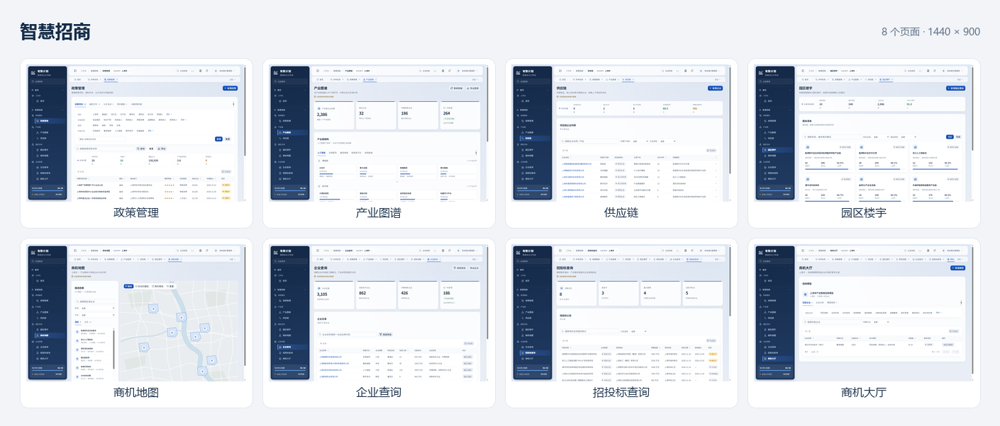
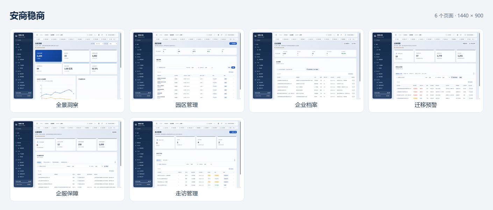

# 有数计划 · 本地全栈演示平台

产业招商与园区服务办公工作台，涵盖政策、园区、企业、线索、人员和走访等功能。React 工作台承载全部业务路由，Java 后端提供本地认证、业务记录接口和 MySQL 8 持久化。首页采用“空间感 Bento 政务工作台”布局，统一霁蓝、黛青和鎏金视觉语言。

> 本项目用于本机开发和演示。统计、通知、地图点位和多数企业信息为演示数据；短信、AI 外呼等尚未接入真实服务，成员权限由本地账号、角色和当前会话决定。

新会话交接请先阅读 [PROJECT_SESSION_SUMMARY.md](PROJECT_SESSION_SUMMARY.md)。

## 技术栈

- 前端：React 19、React Router、Vite 5、Tailwind CSS 4、shadcn/ui（Base UI）、Recharts、Cloudflare Turnstile。
- 后端：Java 21、Spring Boot 3.4.5、Spring JDBC、MySQL 8.4、springdoc-openapi。
- 地图：SVG 示意底图与本地园区点位，支持范围圈选和关联企业筛选。

## 本地启动

准备 Node.js 20.19+、Docker Desktop 和网络连接。首次构建需要下载依赖，并拉取 MySQL 8.4 镜像。Compose 会在 MySQL 健康检查通过后启动 API。

```bash
npm install
docker compose -p youshu-local up -d --build
npm run dev
```

访问 <http://127.0.0.1:5199>。前端将 `/api` 代理到 `127.0.0.1:8080`。MySQL 在本机绑定 `127.0.0.1:3307`，默认开发连接为数据库 `youshu`、用户 `youshu`、密码 `youshu_local`。本地端口和凭据可通过根目录 `.env` 中的 `MYSQL_HOST_PORT`、`MYSQL_USER`、`MYSQL_PASSWORD` 和 `MYSQL_ROOT_PASSWORD` 覆盖。表结构和完整演示数据分别保存在 [schema.sql](backend/sql/mysql/schema.sql) 与 [seed.sql](backend/sql/mysql/seed.sql)。MySQL 首次创建数据卷时会自动执行这两份 SQL。

默认连接配置可直接运行。需要调整端口或密码时，将 `.env.example` 复制为 `.env` 并编辑对应值。

### 认证配置

Compose 的本机演示环境默认开启演示登录。登录页手机号预填 `127127`，点击「127127 免验证码演示登录」可以直接进入工作台。也可以点击「发送验证码」，使用服务端返回的演示短信码 `127127` 完成短信登录。演示短信码只在 `APP_AUTH_DEMO_LOGIN_ENABLED=true` 时有效，应用配置默认关闭该开关。

账号密码登录使用 Cloudflare Turnstile。`compose.yaml` 内置 Cloudflare 官方测试 site key 和 secret key，便于本机验收。部署到真实环境时，用环境变量覆盖它们，并把 `APP_AUTH_DEMO_LOGIN_ENABLED` 设为 `false`。

```dotenv
APP_AUTH_DEMO_LOGIN_ENABLED=false
APP_AUTH_DEMO_PHONE=127127
APP_AUTH_DEMO_SMS_CODE=127127
APP_AUTH_DEVICE_VERIFICATION_ENABLED=true
APP_AUTH_TURNSTILE_SITE_KEY=你的 Turnstile Site Key
APP_AUTH_TURNSTILE_SECRET_KEY=你的 Turnstile Secret Key
```

当前仓库没有真实短信服务商凭证，因此其他手机号会得到「尚未配置真实短信服务」的明确响应。短信接口契约已经保留在 `/api/auth/sms/send` 和 `/api/auth/sms/login`，接入供应商时只需替换服务端发送实现。账号密码首次登录或未信任设备时，服务端可以发起短信设备验证，并在勾选信任设备后保存 90 天可信设备 token。

### 停止与数据

前端终端按 `Ctrl+C`，然后执行：

```bash
docker compose -p youshu-local down
```

命令会保留 Docker 卷 `youshu-local_youshu_mysql_data` 中的 MySQL 数据。不要加 `-v`，否则会删除数据库卷。首次启动会导入 108 条演示记录。原有文件数据库中的记录不会自动迁入 MySQL，新库会从演示 SQL 初始化。旧数据卷仍保留，可按需单独检查。

## 系统操作说明

截图使用隔离的本地演示数据库，所有应用视图固定为 **1440 × 900**。模块总览把同一模块的页面排在一起，展开下方索引可打开每个页面的原尺寸截图。主导航共覆盖 27 个页面，另含 4 个业务详情页和登录、通知、地图、线索解锁等交互状态。

### 全部功能总览







<details>
<summary>打开全部页面的 1440 × 900 原尺寸截图索引</summary>

#### 首页

| 页面 | 截图 |
| --- | --- |
| 首页与 Bento 工作台 | [查看原图](docs/screenshots/features/home.png) |

#### 智慧招商

| 页面 | 截图 |
| --- | --- |
| 政策管理与项目匹配 | [查看原图](docs/screenshots/features/policy.png) |
| 产业图谱 | [查看原图](docs/screenshots/features/industry-chart.png) |
| 供应链 | [查看原图](docs/screenshots/features/supply-chain.png) |
| 园区楼宇 | [查看原图](docs/screenshots/features/parks-buildings.png) |
| 商机地图与范围圈选 | [查看原图](docs/screenshots/features/business-map.png) |
| 企业查询 | [查看原图](docs/screenshots/features/company-search.png) |
| 招投标查询 | [查看原图](docs/screenshots/features/bidding.png) |
| 商机大厅 | [查看原图](docs/screenshots/features/business-hall.png) |

#### 商机洞察

| 页面 | 截图 |
| --- | --- |
| 商机摸排 | [查看原图](docs/screenshots/features/business-investigate.png) |
| 企业扩张 | [查看原图](docs/screenshots/features/enterprise-expansion.png) |
| 项目线索池 | [查看原图](docs/screenshots/features/project-clues.png) |
| AI 外呼任务 | [查看原图](docs/screenshots/features/ai-outbound-tasks.png) |
| AI 通话记录 | [查看原图](docs/screenshots/features/ai-outbound-records.png) |
| AI 外呼数据看板 | [查看原图](docs/screenshots/features/ai-outbound-dashboard.png) |

#### 安商稳商

| 页面 | 截图 |
| --- | --- |
| 全景洞察 | [查看原图](docs/screenshots/features/panoramic-insight.png) |
| 园区管理 | [查看原图](docs/screenshots/features/campus-admin.png) |
| 企业档案与多维筛选 | [查看原图](docs/screenshots/features/corporate-archives.png) |
| 迁移预警 | [查看原图](docs/screenshots/features/migration-warning.png) |
| 企服保障 | [查看原图](docs/screenshots/features/guarantee.png) |
| 走访管理 | [查看原图](docs/screenshots/features/visit-manage.png) |

#### 平台管理

| 页面 | 截图 |
| --- | --- |
| 人员管理 | [查看原图](docs/screenshots/features/members.png) |
| 角色管理与权限配置 | [查看原图](docs/screenshots/features/roles.png) |
| 操作日志 | [查看原图](docs/screenshots/features/logs.png) |
| 操作日志统计 | [查看原图](docs/screenshots/features/log-statistics.png) |
| 门店装修 | [查看原图](docs/screenshots/features/store-settings.png) |
| 接口计费 | [查看原图](docs/screenshots/features/interface-billing.png) |

#### 详情页面

| 页面 | 截图 |
| --- | --- |
| 政策详情 | [查看原图](docs/screenshots/features/policy-detail.png) |
| 企业详情 | [查看原图](docs/screenshots/features/company-detail.png) |
| 园区详情 | [查看原图](docs/screenshots/features/park-detail.png) |
| 项目线索详情 | [查看原图](docs/screenshots/features/clue-detail.png) |

#### 登录及业务交互

| 状态 | 截图 |
| --- | --- |
| 短信演示登录与 127127 免验证码入口 | [查看原图](docs/screenshots/login.png) |
| 账号密码与图片验证码登录 | [查看原图](docs/screenshots/login-password.png) |
| 通知中心右侧抽屉 | [查看原图](docs/screenshots/notifications.png) |
| 政策详情右侧抽屉 | [查看原图](docs/screenshots/features/policy-detail-drawer.png) |
| 商机地图多边形圈选 | [查看原图](docs/screenshots/map.png) |
| AI 外呼话术配置引导 | [查看原图](docs/screenshots/features/ai-outbound-setup.png) |
| 项目线索 10 积分解锁确认 | [查看原图](docs/screenshots/features/project-unlock-dialog.png) |

</details>

### 登录与演示环境

本机演示环境打开即显示短信登录。手机号默认是 `127127`，可使用免验证码按钮进入，也可发送并输入演示码 `127127`。新 MySQL 数据库首次启动时还没有本地管理员，首次使用账号密码页会引导创建账号。账号至少 3 个字符、密码至少 10 个字符，并需要完成人机验证。关闭 Turnstile 配置时，后端会回退到绑定 Session 的图片验证码，验证码 5 分钟有效且提交后失效。

本次全功能截图在独立的临时演示数据库中采集。AI 外呼截图包含话术配置引导、任务、通话记录和看板，测试用配置随临时实例结束，不写入本机 MySQL 数据卷。

### 业务操作

- **政策管理**：按地区、级别、行业或关键词筛选。点击一行可在右侧查看申报条件、扶持力度和截止日期，并生成海报。一键政策匹配根据企业名称、行业和区域计算匹配分数。
- **园区楼宇**：按区域、载体类型或关键词筛选，切换卡片和列表，点击园区查看详情。新增载体保存到 MySQL，刷新后可继续查看。
- **园区管理与走访**：维护园区及楼宇运营信息，创建走访工单，完成时填写结果。工单、状态和完成记录都会保存。
- **企业扩张与项目线索**：企业扩张页提供七组筛选。项目线索页区分线索池与已解锁项目，并可按意愿度分层。每日 50 积分，解锁扣减 10 积分，按北京时间 00:00 恢复，重复解锁不重复扣减。
- **人员和角色**：在平台管理中维护成员及角色。菜单权限控制导航和路由，按钮权限控制可执行操作。后端校验业务 API 权限和授权范围，停用角色后拒绝登录。本地初始管理员保留维护权限。
- **城市、导出与 AI 外呼**：城市切换会联动首页统计。首页、政策和企业页可将异步导出加入顶栏队列并下载 CSV。AI 外呼话术按城市保存，配置后可进入任务、通话记录和数据看板。短信发送、真实电话外呼和转写仍依赖外部供应商。

## API 文档与数据范围

启动后可查阅 [OpenAPI JSON](http://127.0.0.1:8080/v3/api-docs)。先在同一浏览器登录系统再调用业务 API。账号密码登录提交 Turnstile token，图片验证码回退模式提交 `captchaId` 和图片字符。演示短信登录先调用 `/api/auth/sms/send` 获取 challenge，再把 `challengeId` 和短信码提交给 `/api/auth/sms/login`。

后端沿用 `/api/auth/*`、`/api/health`、`/api/records/{collection}` 和 `/api/visits/{id}/complete`，增加项目积分和解锁接口 `/api/workspace/*`。业务记录以 `collection + id` 为主键保存在 `records.payload`，JSON 负载使用 MySQL `TEXT` 存储。旧版企业扩张 URL 继续可用，`/business/enterpriseExpansion/index` 可作为友好入口。

| 模块 | MySQL 8 表和集合 |
| --- | --- |
| 业务集合 | `records` 中的 `policies`、`clues`、`campusList`、`parksBuildings`、`visitOrders`、`visitRecords`、`investigationTasks`、`opportunityModels`、`matchCompanies`、`members`、`roles`、`tenantSettings`、`aiScripts`、`aiTasks` 和 `aiRecords` |
| 初始化状态 | `seed_state`，避免应用启动时重复播种演示记录 |
| 本地管理员 | `local_account` |
| 成员登录账号 | `member_account` |
| 可信设备 | `trusted_device` |
| 项目积分和解锁 | `project_wallet`、`project_unlock` |

需要手动建立表或重新导入演示记录时，可执行仓库中的 SQL 脚本。演示数据脚本使用 `INSERT IGNORE`，重复执行不会覆盖已编辑的业务记录。

```bash
mysql --host 127.0.0.1 --port 3307 --user youshu --password --database=youshu < backend/sql/mysql/schema.sql
mysql --host 127.0.0.1 --port 3307 --user youshu --password --database=youshu < backend/sql/mysql/seed.sql
```

## 本次更新（相对 v1.0.0 / 54c660e）

- 新增 Java 后端、MySQL 8 表结构和演示数据 SQL、会话认证、图片验证码、业务记录接口、Swagger 和 Docker 配置。
- 新增 React 工作台与 shadcn 组件体系，完成业务路由从 iframe 兼容层到 React 页面迁移。
- 更新配色、品牌、导航层级、图标、页签、搜索、通知快捷跳转和登录界面，增加界面素材。
- 接入高德底图与演示点位，优化点位更新和页面监听，调整弹窗遮罩、内容宽度及滚动。
- 更新政策、园区、人员、角色、走访和线索等页面的本地 API 操作，增加 CSV 导出和服务工单联动。
- 增加 Cloudflare Turnstile、`127127` 本机演示登录、短信 challenge、设备可信 90 天记录和验证码测试。
- 完成 Bento 首页、浮动导航轨道、玻璃质感顶栏、城市级联选择器、报告导出队列入口和趋势/空间组合卡片。
- 按业务路由拆分 React 页面，统一内页玻璃卡片、状态胶囊和 10 / 20 / 50 条分页。
- 接通项目积分、角色守卫、持久化外呼配置、城市联动和异步导出队列。
- 更新工作台首屏、侧栏通知和商机地图圈选截图，并补齐 27 个导航页面、4 个详情页面和核心交互状态的 1440 × 900 截图索引。

## 验证

```bash
npx tsc --noEmit
npm run build
docker compose -p youshu-test --profile test run --rm backend-test
docker compose -p youshu-test --profile test down
```

测试服务会使用独立的 MySQL 8.4 临时数据库，运行后通过 `down` 移除测试容器，不读写本机演示数据库卷。构建可能提示部分资源包较大。
