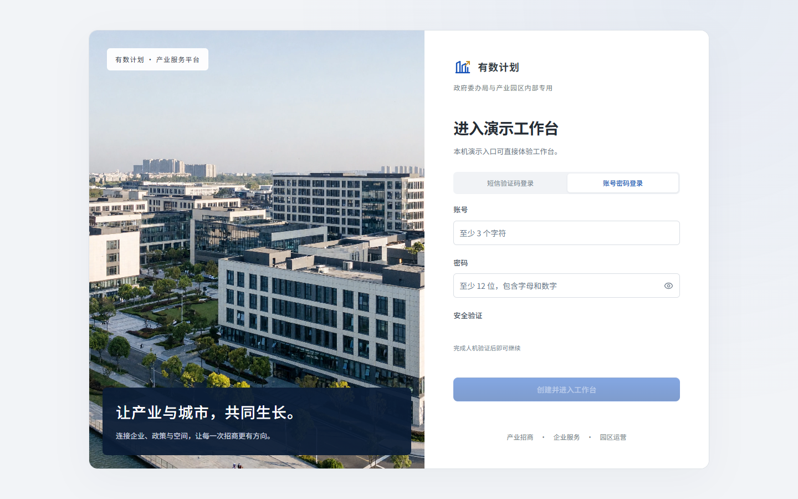
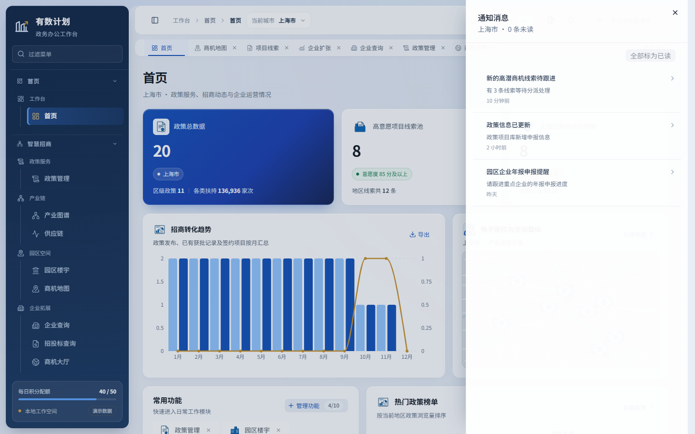

# 有数计划 · 本地全栈演示平台

产业招商与园区服务办公工作台，涵盖政策、园区、企业、线索、人员和走访等功能。React 工作台承载全部业务路由，Java 后端提供本地认证、业务记录接口和 H2 持久化。首页采用“空间感 Bento 政务工作台”布局，统一霁蓝、黛青和鎏金视觉语言。

> 本项目用于本机开发和演示。统计、通知、地图点位和多数企业信息为演示数据；短信、AI 外呼等尚未接入真实服务，成员权限由本地账号、角色和当前会话决定。

新会话交接请先阅读 [PROJECT_SESSION_SUMMARY.md](PROJECT_SESSION_SUMMARY.md)。

## 技术栈

- 前端：React 19、React Router、Vite 5、Tailwind CSS 4、shadcn/ui（Base UI）、Recharts、Cloudflare Turnstile。
- 后端：Java 21、Spring Boot 3.4.5、Spring JDBC、H2 文件数据库、springdoc-openapi。
- 地图：SVG 示意底图与本地园区点位，支持范围圈选和关联企业筛选。

## 本地启动

准备 Node.js 20.19+、Docker Desktop 和网络连接。首次构建需要下载依赖。

```bash
npm install
docker compose -p youshu-local up -d --build
npm run dev
```

访问 <http://127.0.0.1:5199>。前端将 `/api` 代理到 `127.0.0.1:8080`。端口被占用时需停止占用服务或调整配置。

### 认证配置

Compose 的本机演示环境默认开启演示登录。登录页手机号预填 `127127`，点击「127127 免验证码演示登录」可以直接进入工作台。也可以点击「发送验证码」，使用服务端返回的演示短信码 `127127` 完成短信登录。演示短信码只在 `APP_AUTH_DEMO_LOGIN_ENABLED=true` 时有效，应用配置默认关闭该开关。

账号密码登录使用 Cloudflare Turnstile。`compose.yaml` 内置 Cloudflare 官方测试 site key 和 secret key，便于本机验收。部署到真实环境时，用环境变量覆盖它们，并把 `APP_AUTH_DEMO_LOGIN_ENABLED` 设为 `false`。

```dotenv
APP_AUTH_DEMO_LOGIN_ENABLED=false
APP_AUTH_DEMO_PHONE=127127
APP_AUTH_DEMO_SMS_CODE=127127
APP_AUTH_DEVICE_VERIFICATION_ENABLED=true
APP_AUTH_TURNSTILE_SITE_KEY=你的 Turnstile Site Key
APP_AUTH_TURNSTILE_SECRET_KEY=你的 Turnstile Secret Key
```

当前仓库没有真实短信服务商凭证，因此其他手机号会得到「尚未配置真实短信服务」的明确响应。短信接口契约已经保留在 `/api/auth/sms/send` 和 `/api/auth/sms/login`，接入供应商时只需替换服务端发送实现。账号密码首次登录或未信任设备时，服务端可以发起短信设备验证，并在勾选信任设备后保存 90 天可信设备 token。

### 停止与数据

前端终端按 `Ctrl+C`，然后执行：

```bash
docker compose -p youshu-local down
```

命令会保留 Docker 卷 `youshu-local_youshu_data` 中的 H2 数据；不要加 `-v`，否则会删除数据卷。首次启动会向空数据库导入演示记录。升级时，后端会补建本次新增的数据集合。旧版只保存在浏览器里的自定义配置不会自动导入 H2。

## 系统操作说明

以下截图来自隔离演示环境。工作台、通知抽屉和商机地图统一使用 1440×900 固定视口。

### 1. 演示登录与管理员登录

本机演示环境打开即显示短信登录。手机号默认是 `127127`，可使用免验证码按钮进入，也可发送并输入演示码 `127127`。账号密码登录仍要求账号至少 3 个字符、密码至少 10 个字符和 Turnstile 人机验证。关闭 Turnstile 配置时，后端会回退到绑定 Session 的高质量图片验证码，验证码 5 分钟有效且提交后失效。




### 2. 工作台与菜单

左侧按业务分组，点击分组或二级栏目可展开、收起，侧栏支持折叠为纯图标模式。顶部玻璃质感栏提供当前城市级联选择、⌘K 全局搜索、报告导出队列、通知抽屉和账号菜单，页签用于切换页面，右侧“页签”可关闭其他页签或回到首页。首页以 1+2 KPI、7:5 趋势与空间卡片、常用功能和热门政策榜单组织信息密度；点击右上角账号可退出登录。


### 3. 通知消息

点击铃铛从右侧打开通知。打开单条消息或选择「全部标为已读」会更新当前账号在本浏览器的已读状态。清空未读后，顶栏红点消失。通知内容为演示数据。



### 4. 政策、园区和走访

- **政策管理**：按地区、级别、行业或关键词筛选。点击一行可在右侧查看申报条件、扶持力度和截止日期，并生成海报。一键政策匹配通过企业档案、输入的行业和区域计算分数。
- **园区楼宇**：按区域、载体类型或关键词筛选，切换卡片和列表，点击园区查看详情。新增载体保存到 H2，刷新后可继续查看。
- **园区管理**：在“安商稳商 → 园区运营 → 园区管理”中维护园区，已接入本地数据库。
- **走访管理**：创建走访工单，完成时填写结果；完成操作会生成走访记录并保存。
- **人员和角色**：在“平台管理 → 账号权限”中维护成员及角色。为成员配置登录账号、初始密码和角色。菜单权限决定导航和可访问路由，按钮权限决定可执行操作。后端校验业务 API 权限和授权范围，角色停用后拒绝登录。首次初始化的本地管理员保留维护权限。

在企业扩张页可按七组条件查询示例信号。项目线索页按意愿度分层，并区分项目线索池和已解锁项目。本地账号每天获得 50 积分，解锁扣减 10 积分，配额按北京时间 00:00 恢复。重复解锁不会重复扣减。nshots/map.png)

### 6. 城市、导出与 AI 外呼

城市切换会重新按当前区域聚合首页 KPI、按月趋势、区县图表和热门政策。各城市展示已有记录，缺少记录时显示空状态。区县映射来自本地行政区划数据。[数据来源](https://github.com/modood/Administrative-divisions-of-China)

首页、政策和企业页导出后，可在顶栏报告队列查看生成进度并下载 CSV。导出队列保存在当前工作台会话中。

AI 外呼按城市保存开场、问答和结束语。完成配置后可独立访问外呼任务、通话记录和外呼看板。已有录音或转写字段时会在通话详情显示。当前通话记录来自演示数据，真实电话外呼、短信发送和转写依赖外部供应商。

## API 文档与数据范围

启动后可查阅 [OpenAPI JSON](http://127.0.0.1:8080/v3/api-docs)。先在同一浏览器登录系统再调用业务 API。账号密码登录提交 Turnstile token，图片验证码回退模式提交 `captchaId` 和图片字符。演示短信登录先调用 `/api/auth/sms/send` 获取 challenge，再把 `challengeId` 和短信码提交给 `/api/auth/sms/login`。

后端沿用 `/api/auth/*`、`/api/health`、`/api/records/{collection}` 和 `/api/visits/{id}/complete`，增加项目积分和解锁接口 `/api/workspace/*`。旧版企业扩张 URL 继续可用，`/business/enterpriseExpansion/index` 可作为友好入口。

| 模块 | H2 集合或表 |
| --- | --- |
| 政策、项目线索、积分和解锁 | `policies`、`clues`、`project_wallet`、`project_unlock` |
| 园区管理、园区楼宇、走访 | `campusList`、`parksBuildings`、`visitOrders`、`visitRecords` |
| 商机摸排、商机大厅 | `investigationTasks`（含操作记录）、`opportunityModels`、`matchCompanies`（含联系标记） |
| 成员、角色、门店装修 | `members`、`roles`、`member_account`、`tenantSettings` |
| AI 外呼 | `aiScripts`、`aiTasks`、`aiRecords` |

## 本次更新（相对 v1.0.0 / 54c660e）

- 新增 Java 后端、H2 初始化数据、会话认证、图片验证码、业务记录接口、Swagger 和 Docker 配置。
- 新增 React 工作台与 shadcn 组件体系，完成业务路由从 iframe 兼容层到 React 页面迁移。
- 更新配色、品牌、导航层级、图标、页签、搜索、通知快捷跳转和登录界面，增加界面素材。
- 接入高德底图与演示点位，优化点位更新和页面监听，调整弹窗遮罩、内容宽度及滚动。
- 更新政策、园区、人员、角色、走访和线索等页面的本地 API 操作，增加 CSV 导出和服务工单联动。
- 增加 Cloudflare Turnstile、`127127` 本机演示登录、短信 challenge、设备可信 90 天记录和验证码测试。
- 完成 Bento 首页、浮动导航轨道、玻璃质感顶栏、城市级联选择器、报告导出队列入口和趋势/空间组合卡片。
- 按业务路由拆分 React 页面，统一内页玻璃卡片、状态胶囊和 10 / 20 / 50 条分页。
- 接通项目积分、角色守卫、持久化外呼配置、城市联动和异步导出队列。
- 更新工作台首屏、侧栏通知和商机地图圈选截图。

## 验证

```bash
npx tsc --noEmit
npm run build
docker run --rm -v "${PWD}/backend:/app" -w /app maven:3.9-eclipse-temurin-21 mvn -q test
```

最后一条命令中的 `${PWD}` 写法适用于 PowerShell；其他 shell 请改用对应的当前目录变量。构建可能提示部分资源包较大。
