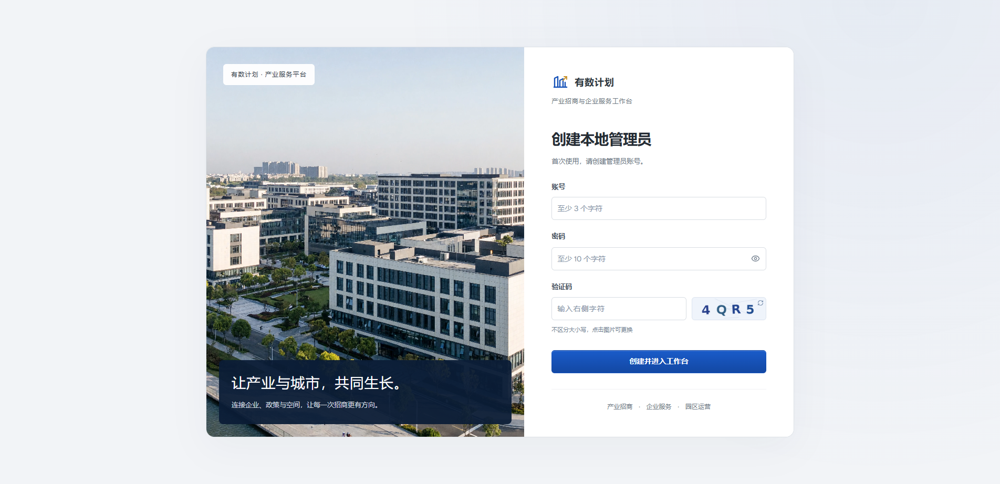
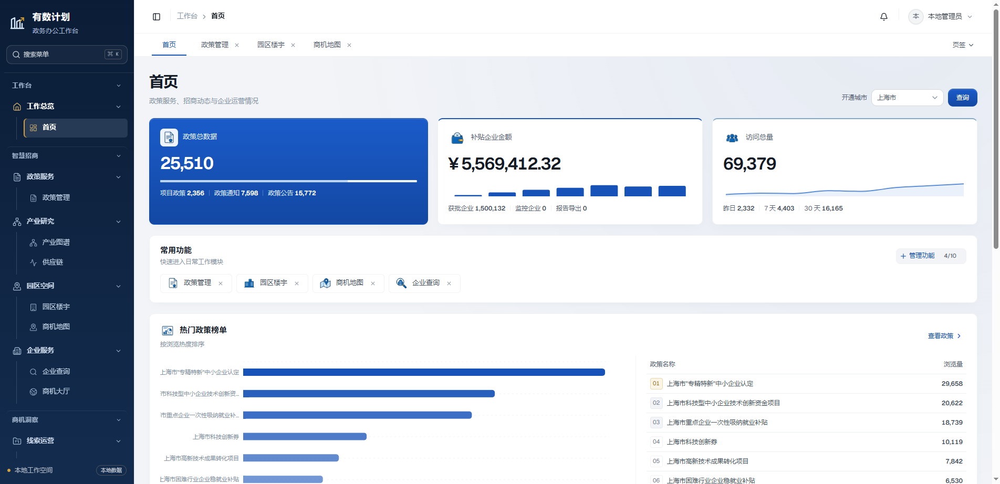
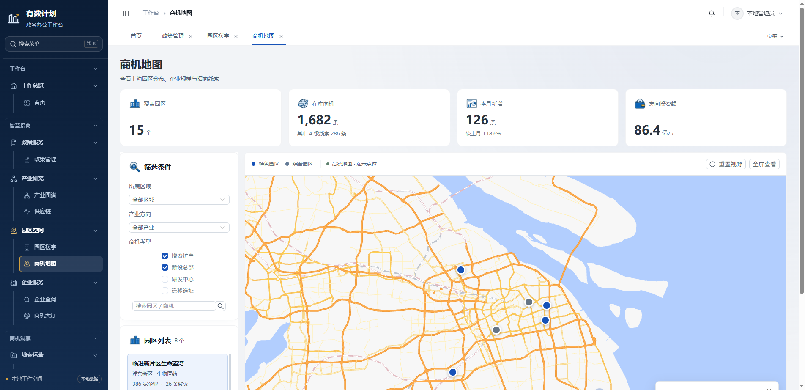

# 有数计划 · 本地全栈演示平台

产业招商与园区服务办公工作台，涵盖政策、园区、企业、线索、人员和走访等功能。React 工作台承载 Vue 业务页面；Java 后端提供本地认证、部分业务接口和 H2 持久化。

> 本项目用于本机开发和演示。统计、通知、地图点位和多数企业信息为演示数据；短信、AI 外呼等尚未接入真实服务，权限控制不完整，不应直接用于生产或存放真实敏感数据。

## 技术栈

- 前端：React 19、React Router、Vite 5、Tailwind CSS 4、shadcn/ui（Base UI）、Recharts；业务页面使用 Vue 3、Vue Router、Ant Design Vue、ECharts。
- 后端：Java 21、Spring Boot 3.4.5、Spring JDBC、H2 文件数据库、springdoc-openapi。
- 地图：高德 Web JS API 2.0，园区和商机点位为演示数据。

## 本地启动

准备 Node.js 20.19+、Docker Desktop 和网络连接。首次构建需要下载依赖。

```bash
npm install
docker compose -p youshu-local up -d --build
npm run dev
```

访问 <http://127.0.0.1:5199>。前端将 `/api` 代理到 `127.0.0.1:8080`。端口被占用时需停止占用服务或调整配置。

### 高德地图

复制 `.env.example` 为 `.env.local`，填入高德 **Web 端 JS API Key** 和安全密钥，重启前端：

```dotenv
VITE_AMAP_KEY=你的Web端JS_API_Key
VITE_AMAP_SECURITY_CODE=你的安全密钥
```

配置成功后显示高德底图；缺少配置或网络不可用时显示本地示意图。`.env.local` 已加入 Git 忽略规则。该版本的前端配置会发送到浏览器，部署时应按照高德要求配置安全代理与域名限制。

### 停止与数据

前端终端按 `Ctrl+C`，然后执行：

```bash
docker compose -p youshu-local down
```

命令会保留 Docker 卷 `youshu-local_youshu_data` 中的 H2 数据；不要加 `-v`，否则会删除数据卷。首次启动会向空数据库导入演示记录。

## 系统操作说明

以下为隔离演示环境中的实际浏览器截图；为展示工作台使用了测试认证状态，数据与通知均为演示内容。

### 1. 创建管理员与登录

首次打开时创建本地管理员：账号至少 3 个字符、密码至少 10 个字符。输入图片中的 4 位验证码，点击图片可换一张；验证码不区分大小写、5 分钟有效，提交后失效。以后使用该账号、密码和新的验证码登录。



### 2. 工作台与菜单

左侧按业务分组，点击分组或二级栏目可展开、收起，选择三级菜单进入页面。顶部页签用于切换页面，右侧“页签”可关闭其他页签或回到首页。点击“搜索菜单”查找功能。首页“管理功能”可调整常用入口；点击右上角账号可退出登录。



### 3. 通知消息

点击右上角铃铛打开通知，点击消息可进入项目线索、对应政策详情或企服保障页面。通知目前为固定演示内容。


### 4. 政策、园区和走访

- **政策管理**：按地区、级别、行业或关键词筛选，选择政策查看详情，也可新增演示政策。
- **园区楼宇**：按区域、载体类型或关键词筛选，切换卡片和列表，点击园区查看详情。此页面新增的载体目前为前端演示状态，刷新后不保证保留。
- **园区管理**：在“安商稳商 → 园区运营 → 园区管理”中维护园区，已接入本地数据库。
- **走访管理**：创建走访工单，完成时填写结果；完成操作会生成走访记录并保存。
- **人员和角色**：在“平台管理 → 账号权限”中维护成员及角色。角色设置可保存，但目前没有细粒度权限校验。

筛选、详情和保存能力以各页面实际实现为准；部分指标及导出、外呼、计费等为演示交互。

### 5. 商机地图

进入“智慧招商 → 园区空间 → 商机地图”。使用左侧区域、产业、商机类型和关键词筛选；点击园区列表或地图点位查看信息，“查看商机”打开线索抽屉，“重置视野”恢复地图范围。底图服务和演示点位状态显示在地图上方。



## API 文档与数据范围

启动后访问 [Swagger UI](http://127.0.0.1:8080/swagger-ui.html) 或 [OpenAPI JSON](http://127.0.0.1:8080/v3/api-docs)。先在同一浏览器登录系统再调用业务 API；直接调用认证接口时，先请求 `/api/auth/captcha`，在同一会话中提交验证码 ID 与图片字符。

后端提供 `/api/auth/*`、`/api/health`、`/api/records/{collection}` 和 `/api/visits/{id}/complete`。持久化数据集包括 `members`、`campusList`、`visitOrders`、`visitRecords`、`roles`、`policies`、`clues`。并非所有界面操作均接入这些接口。

## 本次更新（相对 v1.0.0 / 54c660e）

- 新增 Java 后端、H2 初始化数据、会话认证、图片验证码、业务记录接口、Swagger 和 Docker 配置。
- 新增 React 工作台与 shadcn 组件体系，保留嵌入的 Vue 业务页面。
- 更新配色、品牌、导航层级、图标、页签、搜索、通知快捷跳转和登录界面，增加界面素材。
- 接入高德底图与演示点位，优化点位更新和页面监听，调整弹窗遮罩、内容宽度及滚动。
- 更新政策、园区、人员、角色、走访和线索等页面的部分本地 API 操作，其他演示交互仍保留。
- 增加验证码测试、地图配置示例、截图和操作文档。完整逐文件变更可查看本次 GitHub 提交 diff。

## 验证

```bash
npx tsc --noEmit
npm run build
docker run --rm -v "${PWD}/backend:/app" -w /app maven:3.9-eclipse-temurin-21 mvn -q test
```

最后一条命令中的 `${PWD}` 写法适用于 PowerShell；其他 shell 请改用对应的当前目录变量。构建可能提示部分资源包较大。
