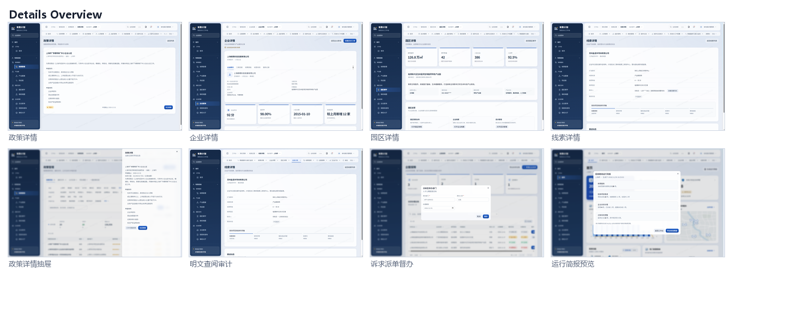

# 有数计划 · 政务招商与安商稳商工作台

**面向地方政府委办局与产业园区管委会的纯 ToG 数字化招商稳商工作台。** 将产业招商、项目流转、企业服务和内部治理放进同一套可审计、可授权、可持续扩展的工作流程。

| 业务域 | 解决的工作问题 |
| --- | --- |
| 智慧招商 | 政策、产业链、园区载体、企业与商机分散，难以形成统一研判视图 |
| 商机洞察 | 企业信号缺少统一匹配、归属保护和从线索到落地的推进记录 |
| 安商稳商 | 企业迁移风险、诉求受理、走访办理与超期督办缺少闭环 |
| 平台治理 | 部门、角色、数据范围、敏感信息授权和操作审计各自割裂 |


> 当前仓库提供可运行的本地政务演示环境。业务数据为合成样例，真实短信、外呼、工商和政务数据源需由部署单位配置服务接口与凭据。

## 产品设计与亮点

- **霁蓝、黛青、鎏金 Bento 视觉体系**：面向政务内部工作的空间式信息编排、统一状态与权限交互。
- **纯 SVG 离线地图**：电子围栏、拖动、矩形框选和多边形圈选不依赖外部地图瓦片，园区点位与围栏遵循 GeoJSON Feature/Polygon 和 `[lng, lat]` 坐标契约。地图按等比呈现并支持滚轮缩放与平移约束，园区点位通过 `ResizeObserver` 实测的 letterbox 换算与电子围栏保持居中对齐。
- **层级化导航与多页签**：面包屑按「工作台 > 分组 > 子分组 > 当前页」四级展开，页签支持自动滚入视野与「关闭右侧」，便于在 30+ 业务页面间连续作业。
- **统一表单与表格交互**：所有业务下拉统一使用同一套选择器组件，表格提供吸顶表头、骨架屏与空态重置，列表在数据加载、失败与无结果三种状态下分别呈现。
- **中文字段与确认交互**：业务详情抽屉统一按中文标签渲染，不直接暴露 `parkId`、`departmentId` 等内部技术字段；破坏性操作统一使用自定义确认弹窗并写入审计记录。
- **授权直出与敏感信息留痕**：项目和企业信息按岗位授权展示，联系人手机号默认掩码。具备授权的用户查看明文号码时立即写入 MySQL 审计日志。
- **全量 MySQL 审计与行级隔离**：业务修改、登录安全事件、导出和敏感信息查阅进入 `op_log`。园区管理员按授权园区访问，专员可限制为仅本人负责。
- **等保三员分立**：系统管理员维护账号和菜单，安全保密员维护数据范围和敏感信息授权，安全审计员只读核查及导出审计记录。后端对日志和明文权限执行强制隔离。
- **可恢复的政务演示**：启用演示登录后，右上角账号菜单提供二次确认的数据恢复操作，并记录审计。账号、部门、角色、系统策略与已有审计日志会保留。

### 5 分钟演示动线

1. **首页 Bento 态势与城市切换**：查看招商、政策、企业服务与园区空间概览，切换服务地区。
2. **商机大厅 11 条规则精准匹配**：查看命中信号，打开企业详情，并把匹配对象纳入项目线索。
3. **项目线索推进与敏感号码审计**：演示公海认领、撞单提示、阶段时间轴，再由授权角色查看明文号码并核对审计记录。
4. **迁移预警双因素归因与走访督办**：对照推力和拉力信号记录企业反馈，将高风险企业转为走访督办工单，完成后回写诉求办理。
5. **三员权限与操作日志**：演示不同角色的权限边界，使用安全审计员只读查看并导出操作日志。

## 功能截图

全部工作台页面截图按 1440 × 900 视口采集，六张模块总览为 1440 × 598。截图取自**当前交付包**（`deploy/youshu-docker-package.zip` 解压后 compose 启动的实例），与仓库源码一致。完整的原尺寸截图索引包含首页、各业务页面、详情抽屉、地图圈选、登录、安全查阅、诉求派单、运行简报和演示恢复相关页面。





<details>
<summary>查看所有原尺寸页面截图</summary>

#### 首页

| 页面 | 截图 |
| --- | --- |
| 首页与 Bento 工作台 | [查看截图](docs/screenshots/features/home.png) |

#### 智慧招商

| 页面 | 截图 |
| --- | --- |
| 政策管理与项目匹配 | [查看截图](docs/screenshots/features/policy.png) |
| 产业图谱 | [查看截图](docs/screenshots/features/industry-chart.png) |
| 供应链 | [查看截图](docs/screenshots/features/supply-chain.png) |
| 园区楼宇 | [查看截图](docs/screenshots/features/parks-buildings.png) |
| 商机地图与 GeoJSON 围栏圈选 | [查看截图](docs/screenshots/features/business-map.png) |
| 企业查询 | [查看截图](docs/screenshots/features/company-search.png) |
| 招投标查询 | [查看截图](docs/screenshots/features/bidding.png) |
| 商机大厅 | [查看截图](docs/screenshots/features/business-hall.png) |

#### 商机洞察

| 页面 | 截图 |
| --- | --- |
| 商机摸排 | [查看截图](docs/screenshots/features/business-investigate.png) |
| 企业扩张 | [查看截图](docs/screenshots/features/enterprise-expansion.png) |
| 项目线索 | [查看截图](docs/screenshots/features/project-clues.png) |
| AI 外呼任务 | [查看截图](docs/screenshots/features/ai-outbound-tasks.png) |
| AI 通话记录 | [查看截图](docs/screenshots/features/ai-outbound-records.png) |
| AI 外呼数据看板 | [查看截图](docs/screenshots/features/ai-outbound-dashboard.png) |

#### 安商稳商

| 页面 | 截图 |
| --- | --- |
| 全景洞察 | [查看截图](docs/screenshots/features/panoramic-insight.png) |
| 园区管理 | [查看截图](docs/screenshots/features/campus-admin.png) |
| 企业档案与多维筛选 | [查看截图](docs/screenshots/features/corporate-archives.png) |
| 迁移预警 | [查看截图](docs/screenshots/features/migration-warning.png) |
| 企服保障 | [查看截图](docs/screenshots/features/guarantee.png) |
| 走访管理 | [查看截图](docs/screenshots/features/visit-manage.png) |

#### 平台治理

| 页面 | 截图 |
| --- | --- |
| 人员管理 | [查看截图](docs/screenshots/features/members.png) |
| 成员新增编辑与授权表单 | [查看截图](docs/screenshots/features/members-form.png) |
| 部门与组织架构 | [查看截图](docs/screenshots/features/departments.png) |
| 角色管理与权限配置 | [查看截图](docs/screenshots/features/roles.png) |
| 三员权限边界与角色配置 | [查看截图](docs/screenshots/features/role-permissions.png) |
| 操作日志 | [查看截图](docs/screenshots/features/logs.png) |
| 操作日志统计 | [查看截图](docs/screenshots/features/log-statistics.png) |
| 系统与门户配置 | [查看截图](docs/screenshots/features/system-settings.png) |
| 数据服务与接口监控 | [查看截图](docs/screenshots/features/interface-monitoring.png) |

#### 详情与流程状态

| 状态 | 截图 |
| --- | --- |
| 政策详情 | [查看截图](docs/screenshots/features/policy-detail.png) |
| 企业详情 | [查看截图](docs/screenshots/features/company-detail.png) |
| 园区详情 | [查看截图](docs/screenshots/features/park-detail.png) |
| 项目线索详情 | [查看截图](docs/screenshots/features/clue-detail.png) |
| 政策详情右侧抽屉 | [查看截图](docs/screenshots/features/policy-detail-drawer.png) |
| 项目线索明文查阅审计 | [查看截图](docs/screenshots/features/project-sensitive-phone.png) |
| 企业诉求派单与督办 | [查看截图](docs/screenshots/features/service-requests.png) |
| 企业诉求详情抽屉 | [查看截图](docs/screenshots/features/guarantee-detail.png) |
| 运行简报预览 | [查看截图](docs/screenshots/features/run-brief.png) |
| 账号菜单与演示恢复确认 | [查看截图](docs/screenshots/features/demo-reset-confirmation.png) |

#### 登录与交互

| 状态 | 截图 |
| --- | --- |
| 短信演示登录与 `127127` 入口 | [查看截图](docs/screenshots/login.png) |
| 账号密码与人机验证 | [查看截图](docs/screenshots/login-password.png) |
| 通知中心右侧抽屉 | [查看截图](docs/screenshots/notifications.png) |
| 商机地图多边形圈选 | [查看截图](docs/screenshots/map.png) |
| AI 外呼话术配置引导 | [查看截图](docs/screenshots/features/ai-outbound-setup.png) |
| 账号菜单与退出入口 | [查看截图](docs/screenshots/features/account-menu.png) |

</details>

## 架构与运行边界

| 能力 | 当前交付 | 生产接入方式 |
| --- | --- | --- |
| 前端工作台 | React 19、TypeScript、Tailwind CSS 4、shadcn/ui、Recharts | 按政府内网域名部署静态资源，API 使用同源代理或内网网关 |
| 业务 API | Java 21、Spring Boot 3.4.5、Spring JDBC | 部署至政务云或单位内网应用区 |
| 持久化 | MySQL 8.4，包含初始化 SQL 和合成演示数据 | 配置正式实例、备份、权限账号、TLS 与保留策略 |
| 登录验证码 | 本地演示免验证码入口；密码登录 Cloudflare Turnstile 测试密钥或绑定 Session 的图片验证码 | 接入单位认可的人机校验服务及正式短信网关，并关闭演示登录 |
| 电话外呼 | AI 话术、任务、记录和看板演示数据持久化 | 对接经审批的语音服务、线路、录音存储和转写服务 |
| 企业与政务数据 | 本地合成企业、园区、政策及风险样例 | 对接获准的工商、信用、招投标、政策、用工和园区系统数据接口 |
| 地图 | 离线 SVG 示意底图与标准 GeoJSON 数据 | GIS 渲染层接入天地图、高德或腾讯内网瓦片，不改变业务坐标契约 |

当前项目**不能替代部署单位的等保测评或生产安全配置**。上线前需按单位要求完成身份源、网络分区、密码与密钥、短信及 GIS 服务、数据来源授权、日志保留和灾备配置。

### 生产演进建议

当前 `records(collection, id, payload)` 通用集合有利于快速交付和中小规模园区按业务集合持久化。若接入省市级百万企业全库，或出现 30+ 维度高频组合筛选，可将 `enterprise`、`policy`、`project_lead` 等高频对象迁为独立关系表，增加面向查询条件的组合索引，并按检索需求引入全文检索。地图渲染可替换为天地图、高德或腾讯内网瓦片，继续沿用 `[lng, lat]` 与 GeoJSON 围栏。

## 5 分钟内启动演示

准备 Node.js 20.19+、Docker Desktop 和网络连接。首次运行会拉取 MySQL 8.4 镜像并构建 Spring Boot API。

```bash
npm install
docker compose -p youshu-local up -d --build
npm run dev
```

打开 <http://127.0.0.1:5199>。前端 Vite 通过 `/api` 连接 `127.0.0.1:8080`，MySQL 绑定 `127.0.0.1:3307`。Compose 会在数据库健康检查通过后启动 API。

本地演示的环境变量如下。

```dotenv
APP_AUTH_DEMO_LOGIN_ENABLED=true
APP_AUTH_DEMO_PHONE=127127
APP_AUTH_DEMO_SMS_CODE=127127
APP_AUTH_DEVICE_VERIFICATION_ENABLED=true
APP_AUTH_TURNSTILE_SITE_KEY=1x00000000000000000000AA
APP_AUTH_TURNSTILE_SECRET_KEY=1x0000000000000000000000000000000AA
MYSQL_HOST_PORT=3307
MYSQL_USER=youshu
MYSQL_PASSWORD=youshu_local
MYSQL_ROOT_PASSWORD=youshu_root_local
```

登录页预填 `127127`，点免验证码入口即可进入。也可发送本地演示短信并输入 `127127`。账号密码登录使用 Compose 内置的 Cloudflare 测试站点密钥。测试密钥只用于本机验收，部署时替换为正式服务配置，并设置 `APP_AUTH_DEMO_LOGIN_ENABLED=false`。

### 五类内置政务角色测试说明

默认演示入口以受限配置的本地演示管理员身份进入，方便浏览全模块。人员记录提供园区专员和只读领导视角的组织样例。要验证真实角色差异，请在人员管理中新建具有登录账号的成员并从角色列表分配以下角色。设置个人测试密码后，首次密码登录须强制修改。

| 角色 | 建议测试方式 | 权限边界 |
| --- | --- | --- |
| 系统管理员 | 新建测试成员并绑定“系统管理员” | 管账号、菜单和单位系统配置，不能读取、导出或删改审计日志，不能给本人授予敏感号码明文权限 |
| 安全保密员 | 新建测试成员并绑定“安全保密员” | 维护数据范围和敏感信息授权，不能读取或导出审计日志 |
| 安全审计员 | 新建测试成员并绑定“安全审计员” | 只读查看操作日志和统计，并可导出审计台账 |
| 园区招商专员 | 使用人员管理中的园区招商专员角色，设置指定园区范围 | 查看授权园区业务，按权限推进线索和走访，不得越园区读取 |
| 只读领导视角 | 使用只读领导视角角色 | 查看获授权的全域业务和汇总，不具备业务新增、编辑、删除权限 |

演示成员记录不附带通用明文密码。这样可直接验证三员角色权限，同时避免 README 或初始化数据发放固定账号口令。系统管理员与安全审计员两个账号不应由同一人员共用。

### 演示数据恢复

仅在服务端 `APP_AUTH_DEMO_LOGIN_ENABLED=true` 且当前会话通过 `127127` 演示登录时，右上角账号菜单显示“恢复初始政务演示数据”。确认后恢复 `seed.json` 中的业务集合并写入 `op_log`。保留成员、角色、部门、系统策略和已有审计记录。演示期间发生的线索、跟进、园区业务和 AI 外呼数据会被覆盖。

### 关闭与数据卷

退出 Vite 开发进程后执行：

```bash
docker compose -p youshu-local down
```

该命令会保留 `youshu-local_youshu_mysql_data` MySQL 数据卷。首次创建 MySQL 卷时自动执行 [schema.sql](backend/sql/mysql/schema.sql) 与 [seed.sql](backend/sql/mysql/seed.sql)。手动导入时可以运行：

```bash
mysql --host 127.0.0.1 --port 3307 --user youshu --password --database=youshu < backend/sql/mysql/schema.sql
mysql --host 127.0.0.1 --port 3307 --user youshu --password --database=youshu < backend/sql/mysql/seed.sql
```

## 权限、审计与 API

权限按页面路由和具体操作进行后端校验。数据范围包含 `ALL_PARKS`、`ASSIGNED_PARKS` 和 `SELF_ONLY`。敏感联系方式列表默认掩码，明文读取经过专用授权并留审计记录。内置三员角色不可修改或删除。运行时角色权限会清除越权的审计与敏感查看节点。

操作日志与系统监控由 MySQL `op_log` 聚合。日志明细、统计与导出仅安全审计员可调用。关键 API 包括：

- `/api/auth/*`：登录、验证码、会话状态、登出与密码变更。
- `/api/records/{collection}`：按授权路由访问持久化业务集合。
- `/api/projects/{id}/sensitive-contact`、`claim`、`release`、`stage`：敏感号码与项目推进闭环。
- `/api/audit/logs`、`/api/audit/statistics`、`/api/audit/export`：安全审计员日志查询、统计和导出。
- `/api/demo/reset`：仅本地演示会话可恢复业务演示数据。
- `/api/system/interface-metrics`：系统调用量、成功率和耗时监控。
- `/api/reports/operation-brief`、`/api/visits/{id}/complete`：运行简报及走访办结。

启动后可在 <http://127.0.0.1:8080/v3/api-docs> 查看 OpenAPI JSON。业务集合以 `records(collection, id, payload)` 存储，审计记录位于专用 `op_log` 表。其余登录会话、可信设备和锁定数据表如下。

| 表 | 用途 |
| --- | --- |
| `records` | 政策、企业线索、园区、组织、角色及业务记录 |
| `seed_state` | 记录初始化集合，防止服务启动时重复覆盖演示数据 |
| `local_account`、`member_account` | 本机管理员和内部成员认证凭据 |
| `auth_session` | 服务端会话状态及强制下线 |
| `trusted_device` | 90 天受信设备令牌摘要 |
| `login_attempt` | 连续失败次数与 15 分钟锁定 |
| `op_log` | 认证、业务操作、敏感信息读取、导出与 API 请求审计 |

## 验证

### 完整 Docker 交付包

仓库提供可直接下载的 [完整 Docker 交付包](deploy/youshu-docker-package.zip)，以及可审阅的 [Docker 交付目录](deploy/docker-package/)。压缩包包含 Spring Boot 可执行 JAR、React 静态前端、Nginx 配置、MySQL 8.4 表结构与初始化数据、环境变量模板和 Docker Compose 文件。下载并解压至 `docker-package` 目录后：

```bash
cd docker-package
cp .env.example .env
# 修改 MYSQL_PASSWORD 与 MYSQL_ROOT_PASSWORD
docker compose up -d
```

入口默认为 <http://127.0.0.1:5199>，MySQL 绑定 <http://127.0.0.1:3307>，可通过 `.env` 中的 `WEB_HOST_PORT` 与 `MYSQL_HOST_PORT` 调整。MySQL 通过命名卷持久化，API 仅在 Compose 内部网络开放，由 Nginx 转发 `/api`。演示验证码配置用于本地演示，部署前应关闭免验证码演示登录并替换验证码服务密钥。交付说明见 [Docker 包 README](deploy/docker-package/README.md)。

交付包中的前端静态资源与仓库 `dist/` 保持一致。**修改前端源码后必须重新同步交付目录并重新打包**，否则压缩包会滞后于源码：

```bash
npx vite build                       # 生成最新 dist
rm -rf deploy/docker-package/frontend/site-final/assets
cp -r dist/assets deploy/docker-package/frontend/site-final/
cp dist/index.html deploy/docker-package/frontend/site-final/
```

验收命令如下：

```bash
npx tsc --noEmit
npm run build
docker compose -p youshu-test --profile test run --rm backend-test
docker compose -p youshu-test --profile test down
docker compose -p youshu-package-verify -f deploy/docker-package/compose.yaml up -d --build
docker compose -p youshu-package-verify -f deploy/docker-package/compose.yaml down -v
```

测试使用独立 MySQL 8.4 临时容器，不读写本机演示数据库卷。打包验收使用独立端口和数据库卷，验收后删除该临时卷；**验收须在压缩包解压目录中执行**，以确保压缩包本身可用，而非仅验证仓库内的交付目录。截图文件位于 `docs/screenshots/`，README 所有本地图片与文件链接均应存在。

更多会话交接信息见 [PROJECT_SESSION_SUMMARY.md](PROJECT_SESSION_SUMMARY.md)。
